<picture><source media="(prefers-color-scheme: dark)" srcset="assets/hero-dark.svg"></picture>

<picture><source media="(prefers-color-scheme: dark)" srcset="assets/social-l-dark.svg"></picture><a href="discordapp.com/users/1377187141662015584"><picture><source media="(prefers-color-scheme: dark)" srcset="assets/social-1-dark.svg"></picture></a><picture><source media="(prefers-color-scheme: dark)" srcset="assets/social-r-dark.svg"></picture>

<a href="https://github.com/bulba2280/Flib"><picture><source media="(prefers-color-scheme: dark)" srcset="assets/project-flib-dark.svg"></picture></a>&nbsp;<a href="https://github.com/bulba2280/CBF"><picture><source media="(prefers-color-scheme: dark)" srcset="assets/project-cbf-dark.svg"></picture></a>

<a href="https://github.com/bulba2280/ForgeTS-"><picture><source media="(prefers-color-scheme: dark)" srcset="assets/project-forgets-dark.svg"></picture></a>&nbsp;<a href="https://github.com/bulba2280/GAT"><picture><source media="(prefers-color-scheme: dark)" srcset="assets/project-gat-dark.svg"></picture></a>

<a href="https://github.com/bulba2280?tab=repositories"><picture><source media="(prefers-color-scheme: dark)" srcset="assets/button-1-dark.svg"></picture></a>

<a href="https://metawka.github.io/expressive-profile/?from=bulba2280"><picture><source media="(prefers-color-scheme: dark)" srcset="assets/credit-dark.svg"></picture></a>

